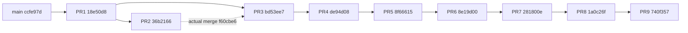

# Math Universe — Integration Readiness Audit

Дата: 2026-10-19. **Итог: NO-GO для интеграции как эксплуатационно готового релиза и production deployment/cutover.** GO только для независимого review и дальнейших согласованных исправлений/изолированных испытаний.

Аудирован tree `740f35742aa585f67471edea2fab5f5205a321f6`, а не будущий коммит отчёта. Ветка: `audit/math-integration-readiness`. Main: `ccfe97dd88b1ebee9bd19795002a30d0bd1c1ca3`. Повторная Git-проверка: **208 ahead / 0 behind, 214 файлов, +8104 / −41 строк**.

Единственное изменение в этой ветке — данный отчёт. Код, tests, SQL, workflows, GitHub settings, main, PR #1–#9 и production gate не исправлялись. Write-пробы использовали только UUID-схемы двух локальных synthetic PostgreSQL-баз. Windows install/update, production migration, cutover, внешние AI/API и реальные PDF книг не запускались. Чтение credentials не требовалось.

## 1. Граф PR и дублирование

GitHub REST snapshot: все девять PR OPEN; #2 не Draft, #1 и #3–#9 Draft. У всех mergeable=true/mergeable_state=clean относительно текущих base. Это не гарантирует отсутствие будущих конфликтов после смены base/heads. GET reviews возвращает [] для каждого PR: GitHub approvals не записаны; обсуждения вне GitHub этим не проверены.

| PR | Base | Head | Коммитов base..head | Файлов |
| --- | --- | --- | ---: | ---: |
| [#1](https://github.com/YehorBabenko88/math/pull/1) | main ccfe97d | feat/math-universe-foundation 18e50d8 | 155 | 112 |
| [#2](https://github.com/YehorBabenko88/math/pull/2) | feat/math-universe-foundation 18e50d8 | feat/book-knowledge-ingestion 36b2166 | 10 | 26 |
| [#3](https://github.com/YehorBabenko88/math/pull/3) | feat/math-universe-foundation 18e50d8 | feat/book-postgres-integration-test bd53ee7 | 34 | 54 |
| [#4](https://github.com/YehorBabenko88/math/pull/4) | feat/book-postgres-integration-test bd53ee7 | feat/book-postgres-backend de94d08 | 6 | 24 |
| [#5](https://github.com/YehorBabenko88/math/pull/5) | feat/book-postgres-backend de94d08 | feat/book-postgres-lossless-json 8f66615 | 5 | 22 |
| [#6](https://github.com/YehorBabenko88/math/pull/6) | feat/book-postgres-lossless-json 8f66615 | feat/book-postgres-cutover-controller 8e19d00 | 2 | 18 |
| [#7](https://github.com/YehorBabenko88/math/pull/7) | feat/book-postgres-cutover-controller 8e19d00 | audit/book-cutover-hardening 281800e | 2 | 18 |
| [#8](https://github.com/YehorBabenko88/math/pull/8) | audit/book-cutover-hardening 281800e | audit/book-migration-integrity 1a0c26f | 2 | 8 |
| [#9](https://github.com/YehorBabenko88/math/pull/9) | audit/book-migration-integrity 1a0c26f | audit/book-full-ci-coverage 740f357 | 2 | 11 |



Сплошные стрелки — declared base, пунктир — включение истории. Проверка `git merge-base --is-ancestor` подтвердила: каждый более ранний head является предком каждого последующего. Merge `f60cbe6749c262056d2df5efa8a8a7e65b39c28b` имеет родителей `4e4ffe36ffb8f286c7dfc8223265c2537fea0256` и head #2 `36b2166466aba08026ad80f8417bf3578bd143e1`.

**Все 10 коммитов #2 уже входят в 34 коммита #3; 24 коммита #3 не входят в #2.** Сумма PR commit counts=218 содержит повторные 10; объединение=208 уникальных коммитов. Других общих коммитов между base..head наборами нет. Общая ancestry всей цепочки при этом имеется. Повторный patch/cherry-pick #2 поверх #3 не нужен. History-preserving merge учитывает общих предков; squash/rebase могут лишить этого преимущества.

### Пересечения файлов

Матрица пересечения GitHub PR file lists; диагональ — размер diff. Это не количество конфликтующих hunks.

| PR | 1 | 2 | 3 | 4 | 5 | 6 | 7 | 8 | 9 |
| --- | ---: | ---: | ---: | ---: | ---: | ---: | ---: | ---: | ---: |
| 1 | 112 | 0 | 6 | 2 | 1 | 0 | 0 | 0 | 5 |
| 2 | 0 | 26 | 26 | 2 | 2 | 1 | 1 | 0 | 1 |
| 3 | 6 | 26 | 54 | 4 | 3 | 1 | 1 | 0 | 2 |
| 4 | 2 | 2 | 4 | 24 | 15 | 4 | 4 | 3 | 2 |
| 5 | 1 | 2 | 3 | 15 | 22 | 4 | 4 | 3 | 2 |
| 6 | 0 | 1 | 1 | 4 | 4 | 18 | 14 | 3 | 0 |
| 7 | 0 | 1 | 1 | 4 | 4 | 14 | 18 | 4 | 0 |
| 8 | 0 | 0 | 0 | 3 | 3 | 3 | 4 | 8 | 0 |
| 9 | 5 | 1 | 2 | 2 | 2 | 0 | 0 | 0 | 11 |

Наиболее чувствительны #4/#5 (15 codec/queue/transfer/migration файлов), #6/#7 (14 controller/journal/backup/auth/queue файлов), #7/#8 (runner и три tests), #1/#9 (пять CI/package/Playwright файлов). Book queue менялся в шести PR, Book runner/PostgreSQL workflow — в пяти. Это эволюционные зависимости, не взаимозаменяемые модули. Нельзя разрешать конфликт выбором старого backend #4 вместе с wire/API #5 или возвращать старый runner/tests вместо #8.

## 2. Совокупный diff и контракты

214 путей: 86 tests, 70 src, 32 docs, 9 SQL, 7 scripts, 4 workflows и 6 корневых путей. Это крупная поставка относительно почти пустого main; review только 11 файлов #9 недостаточен. Просмотрены архитектура, imports/call sites, persistence/queues/review/cutover, frontend и deployment; существующая матрица проверяет numerical/runtime cases. Это не формальное доказательство каждого алгоритма/строки.

| Область | Реальная реализация | Граница готовности |
| --- | --- | --- |
| Научное ядро | SI units, bounded Book formula AST, numeric examples, PDE/torus/experiment graph | Не theorem proof; parser parity/evidence binding имеют дефекты R07/R08 |
| Провайдеры | OpenAlex/Crossref search; нормализаторы пяти источников; alphaXiv/arXiv reference URLs | Полный Agent A/B/C/E pipeline не входит в этот stack — R09 |
| Book ingestion | PDF/source/version/page/text pins, quality/visual review, Codex JSON contract, explicit external consent | Только synthetic qualification; OS containment/real books/identity не доказаны |
| SQLite Book | SHA identity/dedup, acquisition token, checkpoint/reopen/snapshot, WAL/freeze | Bounded local queue, не distributed scheduler и не доказательство остановки всех процессов |
| PostgreSQL Book | Общий queue-contract, ID map, lossless wire v1, receipts/transfer/rollback, SQL001–005 | Explicit staging backend; production gate закрыт |
| Generic PostgreSQL | Отдельные ingestion jobs/adapter snapshots, legacy и fenced stores | Не замена Book API; R02/R03/R10 |
| Frontend | Статический UI, демонстрации, graph import/export, loopback server | Нет сквозного production knowledge repository/backend/explorer |
| CI | Полный inventory в четырёх ячейках, zero-skip gate, отдельные PDF/Browser | Не квалифицирует PowerShell/service и некоторые cross-module DB contracts |
| Windows | Opt-in bootstrap/NSSM/updater и generic worker entrypoint | Синтаксический дефект, устаревший release gate, нет install/reboot/rollback qualification |

Book SQLite/PostgreSQL совместно используют `createBookQueueAPI` из `src/book-ingestion/queue-contract.mjs`: enqueue/acquire/renew/checkpoint/complete/fail/recordReview/get/list/exportSnapshot/importSnapshot. Identity — SHA от sourceHash/edition/page/extractionVersion; token — 64 hex. Snapshot import требует пустого target и инвалидирует leases. Явный sqliteId→PostgreSQL bigint mapping и wire v1 сохраняют NUL/lone surrogates/Unicode keys без очищения; JSONB projection не заменяет исходный wire.

Generic fenced store использует другой claim/job_id/UUID claim_token контракт. `normalize*Lease` — read-only representation, не router. `assessBookQueueCompatibility` остаётся compatible:false. Автоматической подмены backend не найдено; generic queue не реализует Book review/snapshot API.

`runBookJob` завершает stage=review_required. Candidate validator допускает у claims только untested; graph patch требует approved receipt и повторной verification. Formula/Claim остаются untested; reproduced применяется к numeric Evidence, а не доказанности theorem. Paper/job completion/approval не становятся proven автоматически.

Review receipt привязан к digest и source/page/extraction pins; CLI перепроверяет queue candidate. Но reviewer — утверждение доверенного локального caller, не authenticated identity. `recordReview` — storage validation, а не scientific verifier. Registry.validate(passed,checks) тоже принимает trusted caller assertions, не исполняет dimensional benchmark самостоятельно. Нужен host access control.

`importReviewedCandidate` требует repository.transact с hasImport/addNode/addEdge/markImported. Production implementation этих методов в stack отсутствует; browser addSource/addTransform — другой graph API. Моковая transactional repository есть в tests. Это закрытая безопасная граница, но не сквозная product integration.

PDF/sourceData считаются untrusted. Book AST evaluator не использует eval/Function/shell. Parser запускает фиксированный Python script с аргументами, shell:false, ограниченным env/deadline/output/размером. Это не OS sandbox (R11). External AI требует source/page authorization и allowExternalProcessing, budgets/deadline/idempotency key; production account/authorization service здесь не настроен.

## 3. Production cutover остаётся закрытым

Проверены postgres-gate/transfer/json, controller/source/postgres/journal/backup, operator-session, обе Book queue и SQL001–005.

- `BOOK_POSTGRES_BLOCKERS` — frozen непустой `operator-cutover-prerequisites`. Gate немедленно compatible:false, activateBookTransfer=false. Negative probe с throwing pool: **0 connect calls**, activation=false. Строка/boolean не снимают blocker.
- Controller принимает только mode=rehearsal; production отклонён до I/O. READY: productionReady:false; ACTIVATED: simulated:true/backendSwitched:false, source/target остаются fenced. Blockers: trusted-operator-provisioning, worker-process-attestation, database-role-isolation, production-routing-not-integrated.
- Entry-point call-site поиск не нашёл вызовов controller/activate/Book migrations из app/local-server/ingestion-service/CLI. Нет startup env switch на PostgreSQL. openPostgresBookQueue — explicit injected API без auto-migration. Происхождение injected pool библиотека сама не удостоверяет: нельзя указывать rehearsal production DSN.
- SQL001–002 задают data/wire constraints; 003 — STAGING guard, 004 — постоянный epoch/pinned function, 005 — PUBLIC privilege restrictions, monotonic generations/commit-time pair constraints. Ни один SQL не включает production routing. Generic SQL001–004 — отдельный ledger, см. R10.
- SQLite freeze: BEGIN EXCLUSIVE, durable triggers/API fence, fingerprint/integrity/hash, WAL regression. Witness честно сообщает **workerProcessesStopped:false**. Владелец файлов — trust root.
- PostgreSQL supported lock order epoch→guard→metadata; transaction-local capability, stale generations/tokens/snapshots отклоняются. Roles/trusted function owner для production не provisioned; object owner/superuser не ограничены этими обещаниями.
- Journal: WAL/FULL, BEGIN IMMEDIATE, generation/token/lease/hash chain, crash/restart/clock tests. Hash chain без внешнего anchor не защищает от полномочного владельца, переписавшего всё. Ed25519 verifier проверяет issuer/audience/scope/run/resource/TTL и повторно вызывается после async effects; real key provisioning/revocation/global time attestation отсутствуют.
- Backup: VACUUM INTO, integrity/SHA, temporary physical/logical restore, snapshot comparison, повторная проверка перед READY/activation. Synthetic restore evidence не доказывает пригодность production backup.
- Book runner перечитывает raw UTF-8 SHA на каждом run, валидирует ledger/prefix, использует transaction advisory lock. Populated filename-only ledger получает BOOK_MIGRATION_HISTORY_UNVERIFIED: текущие bytes не объявляются историческим evidence. Его adoption остаётся заблокированным.

**Вывод:** случайного production cutover по поддерживаемым startup/API путям в неизменном tree не найдено. Это не гарантия для изменённого кода, произвольного injected verifier/pool или привилегированного владельца. Ничего не активировалось.

## 4. Находки — документирование без исправлений

P1 блокирует соответствующий rollout/готовность; P2 — существенный ограниченный дефект/незавершённый контракт; P3 — hardening/квалификация. P0 не подтверждён. Никакая finding не исправлена в этой ветке.

### R01 — P1: Windows updater синтаксически невалиден

**Файл:** `scripts/windows-update.ps1:74–87`, разрыв начинается на 75. Native PowerShell Parser::ParseFile вернул 5 ошибок: TerminatorExpectedAtEndOfString(75), MissingEndParenthesisAfterStatement(88), MissingEndCurlyBrace(74), MissingEndCurlyBrace(23), MissingCatchOrFinally(88). Разорваны regex/rollback block, дублирован finally. Updater не запускается даже с -CheckOnly; bootstrap -Install не квалифицирован.

**Repro, без исполнения скрипта:**
```powershell
$tokens=$null; $errors=$null
[System.Management.Automation.Language.Parser]::ParseFile((Resolve-Path 'scripts/windows-update.ps1'),[ref]$tokens,[ref]$errors) | Out-Null
$errors | Select-Object ErrorId,Message,@{n='Line';e={$_.Extent.StartLineNumber}}
```
**Предложение:** согласованная отдельная правка rollback block, AST RED/GREEN для обоих PS1, Pester fixtures install/restart/health failure/rollback/custom-root и Windows CI. Не запускать installer до review. **Confidence: confirmed.**

### R02 — P1: adapter registry snapshot не восстанавливается через JSONB

**Файлы:** `src/knowledge-adapter-registry.mjs:5–6`, `src/knowledge-adapter-postgres.mjs:12–25`, `src/knowledge-adapter-persistence.mjs:14–15`, `sql/001_adapter_snapshots.sql:8`. Fingerprint — обычный JSON.stringify с insertion order; JSONB возвращает другой порядок. После успешного save(registry) latest() падает **Registry fingerprint mismatch** на PG16 и PG18. Мок `tests/knowledge-adapter-postgres.test.mjs` сохраняет порядок и не моделирует это свойство БД. Payload остаётся в таблице, но public restore API сломан; необратимая потеря не утверждается.

**Repro:** isolated applyMathMigrations → proposeKnowledgeAdapter(from=a,to=b,relation=equivalent-concept) → registry.propose → store.save → store.latest. Код в §7.

**Предложение:** versioned stable fingerprint/canonical encoding либо сохранение исходных lossless bytes; согласовать существующие IDs/review links, не переписывать IDs молча. Live regression approved/proposed records, key reordering, Unicode и digest verification на PG16/18. latest сейчас также не сверяет сохранённый sha256; при исправлении согласовать hash и representation. **Confidence: reproduced on both engines.**

### R03 — P1 для generic service rollout: service подключён к unfenced store

**Файлы:** `src/ingestion-service.mjs:3,9,14`, `src/ingestion-job-postgres.mjs:47–65`; контраст — `ingestion-job-postgres-fenced.mjs`. Повторный workerId не является acquisition identity. После expiry/reacquire тем же workerId старый complete успешно пишет result в новый acquisition. На PG16/18 подтверждены state=completed и result.writer=expired-acquisition. Наличие fenced store в #3 не защищает service, который его не выбирает.

**Repro:** legacy enqueue → claim(same-worker) → SQL expire lease → claim(same-worker) → complete(old job_id,same-worker). Это intentional legacy BC, но небезопасная конфигурация для rollout как fenced service; finding не относится к Book fenced queue.

**Предложение:** отдельный explicit fenced service mode с проверкой migrations/drain и fail-closed startup, затем service-level same-worker regression. Не заменять stores автоматически и не алиасить Book API. **Confidence: reproduced.**

### R04 — P1 governance blocker: main не защищён, checks/reviews не enforced

**Read-only evidence:** GET branches/main: protected=false; branches/main/protection: HTTP404 **Branch not protected**, не 403; rulesets?includes_parents=true: []; rules/branches/main: []. Branch inventory не содержит protected branches. API-доступ достаточен (repo permissions.admin=true), settings не менялись. GET pulls/{1..9}/reviews: [] у каждого.

Ни Full CI coverage, ни native-pdf, ни chromium не enforced required checks для main. Зелёные workflows не запрещают merge другого/неодобренного SHA.

**Предложение:** отдельным административным решением задать required aggregate/PDF/Browser и review policy, исключить bypass/direct/force push и проверять актуальный merge-base. Проверить уникальность check contexts: `test` теперь лишь CI contract. Этот аудит не меняет settings. **Confidence: confirmed remote snapshot.**

### R05 — P2: Windows release gate игнорирует matrix/PDF и допускает старый success

**Файлы:** `scripts/windows-update.ps1:28–32,44–45`, `.github/workflows/ci.yml`. Updater требует только Validate Math Universe и Browser E2E; после #9 Validate — 4 contract tests. PostgreSQL Integration/PDF не проверяются. Достаточен любой success на SHA, даже при более позднем failed run/attempt. Local Node вызов не требует DB/PDF и не запрещает skips. Сейчас достижимость блокируется R01.

**Repro predicate без исполнения PS1:** workflow_runs с success Validate/Browser и failure PostgreSQL/PDF проходит условие строк 30–32; success(old)+failure(new) для одного workflow тоже даёт success count>0.

**Предложение:** после R01 привязать gate к точному SHA, trusted workflow IDs и актуальным attempts; требовать Full CI coverage/PDF/Browser, prerequisites/zero skips и functional readiness. Исправление parser само по себе не разрешает deployment. **Confidence: static.**

### R06 — P2: зависимости и SQL bytes не воспроизводимы как immutable release

**Файлы:** `package.json:9–12`, PostgreSQL/Browser workflows, `scripts/book-ingestion-requirements.txt`. Package-lock и .gitattributes отсутствуют в tree. pg8.16.3/Playwright1.56.1 pinned напрямую, но npm install заново резолвит transitive ranges. pip версии pinned, artifact hashes/platform runtime — нет. Node22/24 — moving minors, immutable runtime manifest нет. Raw SQL hashes чувствительны к CRLF/BOM; проверенный Windows core.autocrlf=true.

**Repro:** `git ls-tree HEAD package-lock.json .gitattributes` пуст; manifest и installed dependency ranges читаемы локально. Локальные тесты использовали установленный runtime; green GitHub #9 доказывает clean online install только того запуска, не offline reproducibility.

**Предложение:** reviewed lockfile/npm ci и immutable runtime/artifact/byte manifests. Не нормализовать применённые SQL и не backfill historical hashes текущим checkout. Actions @v4/@v5, ubuntu-latest и postgres:major тоже mutable — дополнительный supply-chain hardening, не найденная CVE. **Confidence: confirmed configuration.**

### R07 — P2: scalar и implicit parsers расходятся на unary minus/exponent

**Файлы:** `src/expression.mjs:8–10`, `src/implicit3d.mjs:24–26`. `compileExpression('-x^2').evaluate(2)` → **4**; explicit `-(x^2)` и `compileImplicit('-x^2=0')(2,0,0)` → **−4**. Scalar parser связывает unary раньше power, в отличие от implicit parser/обычной математической записи. Сейчас scalar API не импортируется browser equation editor; finding не утверждает неправильность текущего 3D UI.

**Предложение:** согласовать grammar и RED/GREEN для -x^2, (-x)^2, x^-2, right-associative powers/cross-parser parity, сохраняя no-eval. **Confidence: pure-function repro.**

### R08 — P2: graph evidence не связано с вычисленным output

**Файл:** `src/graph-evidence-validation.mjs:7–10`. evaluated.value не участвует в validateScientificExperiment(spec). Для node values=[999,999] и spec(expected=actual=1m/s) возвращается node-bound evidence.status=reproduced. Scope честно numeric-examples-only, не proven, но это не воспроизведение результата узла.

**Repro:** createScientificExperimentGraph.addSource('measured','time-series',[999,999]); validateGraphNodeEvidence(...,'measured',{claim:'node equals 1',referenceId:'synthetic',locator:'p1',observations:[{expected:1,actual:1,expectedUnit:'m/s',actualUnit:'m/s'}]}). Результат reproduced; graph.execute по-прежнему [999,999].

**Предложение:** обозначать independent citation example без утверждения node-output validation либо bind samples/units/parameters/graph digest к output и независимому benchmark. Добавить mismatch/changed-graph cases. **Confidence: reproduced; proven promotion не найдено.**

### R09 — P2 product gap: научный pipeline не завершён в PR stack

**Файлы:** `src/research-providers.mjs:22–35`, research-library, Book graph-adapter, `index.html:11`; specs codex-parallel-science-plan/alphaxiv-integration/codex-reference-extraction-task.

searchResearch подключает только OpenAlex/Crossref; arXiv/Semantic Scholar/Wikidata searches отклоняются Provider not yet connected. Есть нормализаторы, но нет их Atom/SPARQL clients, request scheduler/cache/rate-limit pipeline. alphaXiv — design/reference URL, не действующий client. Typed Work/Claim/Formula repository отсутствует; browser experiment graph — иной API. Reference-catalog Filchakov/Yavorskiy–Detlaf не входит в tree. Curated Hartshorne/Sveshnikov scenes — другие книги, не результат этой extraction task. UI не связан с Book backend как research explorer.

**Предложение:** явно сузить release scope до standalone demo/Book staging либо separately review независимые feature branches и реальные contracts; не объявлять полную цель шести провайдеров выполненной. Эти ветки здесь не интегрируются. **Confidence: source/call-site inventory, feature gap, не runtime exploit.**

### R10 — P2: generic migration runner остался filename-only

**Файл:** `src/postgres-migrations.mjs:51–64`, generic SQL001–004. Book SHA ledger не распространяется на mu_schema_migrations. После первой установки повтор с readSql, сигнализирующим изменённые bytes, возвращает [] и **ни разу не читает SQL**. На PG16/18 подтверждено. Нельзя переносить гарантии Book001–005 на другой runner.

**Предложение:** отдельно согласовать generic checksum ledger/legacy history policy, catalog/search_path и isolation review, без trust-current-hashes и изменения старых SQL. **Confidence: reproduced; Book checksum tests проходят.**

### R11 — P1 operational blocker для untrusted Windows PDFs: OS containment не доказан

**Файлы:** `scripts/book-ingestion-pdf.py:9–15`, `src/book-ingestion/pdf.mjs:55–80`, Windows docs. На Windows resource module отсутствует. Python socket monkeypatch не ограничивает native PDFium/скомпрометированный parser на уровне ОС. Deadline/env/output/shell:false полезны, но не доказывают memory/filesystem/network isolation. Elevated bootstrap и restricted runtime account — разные полномочия.

**Предложение:** отдельная synthetic containment qualification с restricted non-admin identity, согласованными host process memory/network/filesystem limits, child lifetime и проверенными parser artifacts. Не менять Defender/ACL/sandbox в аудите. Это **неподтверждённая необходимая операционная гарантия**, а не воспроизведённый взлом. **Confidence: explicit source limitation.**

### R12 — P3: custom Windows Root не передаётся launcher

**Файл:** `scripts/windows-update.ps1:2,51–60`. Параметр Root задаёт releases/active/launcher location, но generated launchContent читает hardcoded C:\ProgramData\MathUniverse. При другом Root выбирается иной active/release. Runtime сейчас блокирован R01; service не устанавливался.

**Предложение:** безопасно передавать проверенный Root, добавить custom-path/quoting/rollback fixtures и проверку active pointer. **Confidence: static.**

## 5. CI, permissions и свежая матрица результатов

PR9 rollup подтвердил четыре успешных workflows на audited SHA, включая четыре matrix cells и aggregate:

- [PostgreSQL Integration](https://github.com/YehorBabenko88/math/actions/runs/39230637803)
- [Native PDF](https://github.com/YehorBabenko88/math/actions/runs/39230637820)
- [Browser E2E](https://github.com/YehorBabenko88/math/actions/runs/39230638006)
- [Validate Math Universe](https://github.com/YehorBabenko88/math/actions/runs/39230637798)

Workflows используют contents:read, checkout persist-credentials:false, job timeouts; нет pull_request_target/production secrets/environments. Известный synthetic service password используется только ephemeral PostgreSQL. Matrix fail-fast:false, четыре test-файла одновременно, zero-skip runner с runtime/TAP checks и 120 sec/file. Browser retries=0. Отдельный PDF профиль сам не имеет strict summary wrapper, но full matrix включает его tests и отклонит skips. Обычный optional npm test без env всё ещё может пропускать интеграции — он не release gate.

| Свежая локальная проверка | Результат | Лог вне Git |
| --- | --- | --- |
| Node22.23.3 × PostgreSQL16.15 | 77 файлов, 372 pass; 0 fail/cancel/skip/todo | outputs/readiness-node22-pg16.log |
| Node22.23.3 × PostgreSQL18.1 | 77 файлов, 372 pass; 0 fail/cancel/skip/todo | outputs/readiness-node22-pg18.log |
| Node24.20.0 × PostgreSQL16.15 | 77 файлов, 372 pass; 0 fail/cancel/skip/todo | outputs/readiness-node24-pg16.log |
| Node24.20.0 × PostgreSQL18.1 | 77 файлов, 372 pass; 0 fail/cancel/skip/todo | outputs/readiness-node24-pg18.log |
| Dedicated Native PDF | 76 pass; 0 fail/skip/todo | outputs/readiness-native-pdf.log |
| Browser Chromium, localhost | 14 pass, retries=0 | outputs/readiness-browser.log |
| JSONB / stale legacy claim / generic drift probes | Три дефекта подтверждены на обеих PG версиях | outputs/readiness-probes.log |
| Pure science probes | R07: 4 vs −4; R08: unrelated node-bound example reproduced | outputs/readiness-science-probes.log |
| PowerShell parse-only | **FAIL: 5 syntax errors**, PS1 не исполнялся | outputs/readiness-windows-parse-errors.json |
| Gate negative probes | compatible=false, activate=false, connect calls=0; production mode rejected | outputs/readiness-production-gate.log |
| git diff --check | PASS; только report разрешён к коммиту | Git diff |

Ни один test-файл или тест из полного suite не исключён. Book migrations001–005, stale claims/exhaustion/checkpoint/worker crash, migration concurrency, controller/journal/signed sessions, backup/restore и SQLite WAL входят в suite. Прогоны завершились без зависаний; процессы разных Node пересекались по времени на disposable clusters, каждый fixture владеет UUID schema. Parallel cleanup regression проверяет и callback failure. Существующий historical PG18 schema с ledger001–004 от 2026-10-18 не удалялся; cleanup чужих объектов по prefix недопустим. Запущенные для аудита локальные серверы после проверок останавливаются.

Coverage percentages предыдущего #9 не пересчитывались и не выдаются за текущий замер. Execution всех 372 tests не означает 100% покрытия. Существующий suite пропускает не тесты, а **не имеет scenarios** для PS parsing/install/rollback, настоящего JSONB snapshot round-trip и service-level fenced wiring. E2E использует Python test server, не NSSM/local-server deployment. Не проверены реальные PDF страниц, production restore/roles/IDP, live scientific API/AI, server/power loss, malicious privileged owner, mutation testing. Зелёный suite не отменяет findings.

## 6. Безопасный план интеграции — НЕ ВЫПОЛНЕН

Каждый checkpoint требует отдельного решения владельца и независимого review. Этот план не разрешает merge/settings/data changes сейчас.

1. **Заморозить evidence.** Зафиксировать exact main/heads (§1 и приложение), hashes/artifacts, полный diff и логи. Проверить drift heads/base перед любым следующим шагом. Отчётная ветка меняет только Markdown.
2. **Согласовать remediation/scope.** В новых feature PR сначала RED, затем исправления R01–R03. R04 — отдельное administrative решение. R05/R06 обязательны для deployment, R07/R08 — для квалификации соответствующих scientific API. По R09 явно утвердить deferred scope либо отдельно закончить pipeline. Ни один blocker не закрывается этим отчётом.
3. **Проверить исправленный tip.** Чистая pinned dependency установка, полный unfiltered Node22/24×PG16/18/PDF/Browser, live registry snapshot, service same-worker stale claim, PS AST/Pester. Независимый review cumulative 214+changed files. Старые successes не относятся к новому SHA.
4. **Выбрать одну topology strategy.** Предпочтителен новый integration/release-candidate branch от exact main с включением согласованного final descendant tip обычным history-preserving merge только после разрешения. Tip уже содержит код #1–#9 и merge #2; один cumulative review исключает дублирующее применение patches. Закрытие/пометка существующих PR superseded требует отдельного разрешения, здесь не выполняется.
5. **Если требуется по-PR порядок:** #1→main; отдельно согласованные retarget #2→main/merge; затем retarget #3→main (не cherry-pick повторные 10 коммитов #2); затем #4, #5, #6, #7, #8, #9→main по очереди с retarget каждого после ancestor checkpoint. Альтернатива — признать #2 superseded через #3. После каждого будущего retarget пересчитать diff/ancestry/mergeability и тесты. Не смешивать стратегию с cherry-pick/squash/rebase: нынешняя shared ancestry перестанет гарантировать дедупликацию. Никакого retarget/merge сейчас нет.
6. **Контрольные точки.** C1: foundation/core/browser. C2: Book+generic fencing (#2/#3), явное separation и корректный service mode. C3: lossless backend (#4/#5), text/hash/receipts/rollback. C4: controller/hardening/checksums/full-CI (#6–#9), production gate остаётся закрыт. Промежуточные trees не release-ready: #4 JSON limitations и #6 без #7/#8 hardening нельзя поставлять отдельно. Ни один checkpoint не включает автодеплой.
7. **Staging drill отдельно от code merge.** Только synthetic isolated DB/roles и immutable SQL artifacts; Book001–005 unchanged. Для populated filename-only ledger STOP без оригинального historical evidence; не backfill текущие SHA. Fresh reconstruction возможен лишь separately reviewed workflow. Проверить backup restore до transfer; сохранить source/target hashes, ID mapping, provenance/review receipts и fencing generations. Production DB не использовать.
8. **Windows pilot отдельно.** После R01/R05/R12 сначала parse/mock/Pester, затем отдельное разрешение supervised install на конкретный SHA под restricted account, application health, reboot и rollback drill. Никаких SYSTEM auto-updates по moving development branch. Static UI и scientific DB worker — разные deployment units; отсутствие Book routing нельзя компенсировать автоматическим backend switch.
9. **Rollback кода.** До интеграции — отказаться от candidate branch. После согласованного merge — новый reviewed revert/forward-fix commit, без force/reset/rewrite main; сохранить known-good release SHA. Pointer/service rollback сначала проверить на fixtures/host drill; нынешний updater не является работающим recovery механизмом.
10. **Rollback данных.** Code revert не откатывает schemas/wire/generations. Не запускать старых workers/readers поверх новых данных и не удалять guards/epoch. В staging rollbackBookTransfer допустим только до activation и для неизменённых inserted rows; skipped existing rows не удаляются. При изменениях STOP и отдельное восстановление backup в новую среду. Production recovery требует нового согласованного runbook, verified backups и fencing всех writers; разрешения на него нет.
11. **Отдельный финальный GO.** Независимый reviewer подтверждает closure findings, точный SHA, enforced required checks и agreed scope. Code integration не открывает production gate. Authentication/role isolation/worker attestation/verified production backup/routing — самостоятельные blockers, не снимаемые merge/green CI/confirmation string.

## 7. Воспроизводимые пробы и evidence

Безопасный PS parse-only repro — в R01. Следующий модуль запускается из root clone **только против loopback disposable test DB** (PG18:55439, PG16:55440); production DSN запрещён. withIsolatedPostgres создаёт и удаляет только свою UUID schema. Сохранённый полный вариант: outputs/readiness-probes.mjs/.log, вне Git. Пробы подтверждают текущие дефекты, не исправляют их.

```js
import {withIsolatedPostgres} from './tests/helpers/postgres-isolation.mjs';
import {applyMathMigrations} from './src/postgres-migrations.mjs';
import {proposeKnowledgeAdapter} from './src/knowledge-adapter-planner.mjs';
import {createKnowledgeAdapterRegistry} from './src/knowledge-adapter-registry.mjs';
import {createPostgresAdapterSnapshotStore} from './src/knowledge-adapter-postgres.mjs';
import {createIngestionJobStore} from './src/ingestion-job-postgres.mjs';
await withIsolatedPostgres('postgres://math_test@127.0.0.1:55439/math_universe_integration',async({pool})=>{
 await applyMathMigrations(pool);
 const r=createKnowledgeAdapterRegistry();
 r.propose(proposeKnowledgeAdapter({from:{id:'a',referenceId:'r1',locator:'p1'},to:{id:'b',referenceId:'r2',locator:'p2'},relation:'equivalent-concept'}));
 const store=createPostgresAdapterSnapshotStore(pool);await store.save(r);
 try{await store.latest();}catch(e){console.log(e.message);} // Registry fingerprint mismatch
 const q=createIngestionJobStore(pool);
 await q.enqueue({kind:'verify-candidate',sourceHash:'synthetic',locator:'p1'});
 const old=await q.claim({workerId:'same-worker',leaseSeconds:10});
 await pool.query("UPDATE mu_ingestion_jobs SET lease_until=now()-interval '1 second' WHERE job_id=$1",[old.job_id]);
 await q.claim({workerId:'same-worker',leaseSeconds:10});
 console.log(await q.complete({jobId:Number(old.job_id),workerId:'same-worker',result:{stale:true}})); // wrongly succeeds
 let reads=0;console.log(await applyMathMigrations(pool,{readSql:async()=>{reads++;throw Error('changed SQL')}}),reads); // [],0
});
```

Pure repro без БД:
```js
import {compileExpression} from './src/expression.mjs';
import {compileImplicit} from './src/implicit3d.mjs';
console.log(compileExpression('-x^2').evaluate(2)); // 4
console.log(compileImplicit('-x^2=0')(2,0,0)); // -4
```

Read-only Git/API команды: git rev-list --left-right --count mainSHA...auditedSHA; git diff --numstat mainSHA...auditedSHA; git merge-base --is-ancestor earlierHead laterHead; gh api repos/YehorBabenko88/math/pulls/N, pulls/N/files, pulls/N/reviews, branches/main, branches/main/protection, rulesets?includes_parents=true, rules/branches/main. HTTP404 Branch not protected интерпретирован вместе с protected:false/пустыми rulesets, не как ошибка credentials. Исходные API snapshots сохранены вне Git в outputs/readiness-*.json/jsonl; не являются production secrets.

### Exact heads для независимой повторной проверки

```text
main ccfe97dd88b1ebee9bd19795002a30d0bd1c1ca3
PR1  18e50d855bd3be4bc50da8062f346b8026d01655
PR2  36b2166466aba08026ad80f8417bf3578bd143e1
PR3  bd53ee7486f145dbcc1fc2db8fb13eb04cd7999f
PR4  de94d0803844970c1076655d721f0de59e763cd0
PR5  8f666159da165e04999133fbe76bd0805a36b617
PR6  8e19d00df3767ce6436e3d570b7a6fc661893c36
PR7  281800e142cf64f84edf58c61de0f5f862af5bc4
PR8  1a0c26f7a3cb5f341c3ea9ad8a87009ef33c7b90
PR9  740f35742aa585f67471edea2fab5f5205a321f6
```

## 8. Публикация и стоп-условие

Разрешён только обычный push новой audit/math-integration-readiness с одним Markdown commit. Draft PR/issue/comments не создаются; main и PR #1–#9 не меняются. Report commit SHA/Actions сообщаются отдельно после публикации, чтобы не создавать self-referential hash.

```powershell
git -C 'C:\Users\Administrator\Documents\Codex\2026-10-14\https-github-com-yehorbabenko88-math-actions\work\book-postgres-cutover-controller' push --set-upstream origin audit/math-integration-readiness
```

**Окончательно: NO-GO.** Findings документированы, а не исправлены. Integration plan, production migration и реальный cutover не выполнялись. Отчёт передаётся на независимую проверку.
