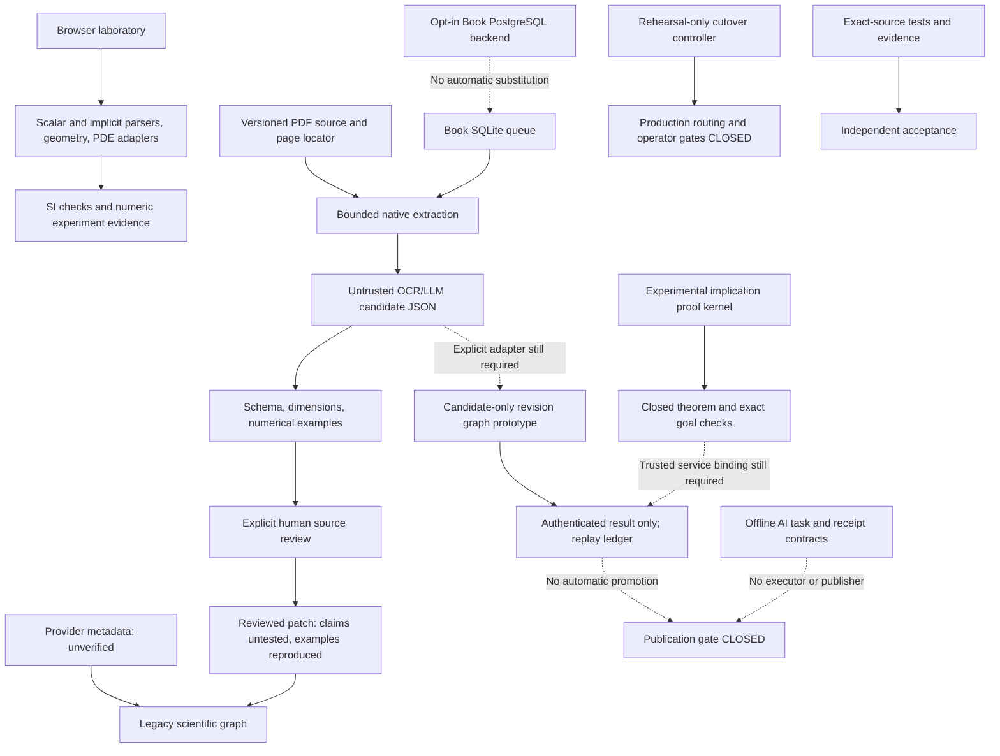

# Math Universe — Issue 20 stabilization and consolidation audit

Date: 2026-10-25. Audited integration: `20ede51c6e5eddbf49fde709f8af5e77a319e1c7`, tree `688d9cdeb45ccc9d6657c981a514dd32635bee99` (Draft PR19). Q01 OPEN pending independent acceptance. Production NO-GO. Book production gate CLOSED.

## Decision and scope

Repository inventory, PR dependency/content map and focused behavioral audits are complete. Confirmed defects have isolated Draft PRs, not an automatically merged replacement for PR19. The Q01 captured failure class now has causal receipts, deterministic RED/GREEN tests and a bounded correction. This is readiness for independent review, not approval to consolidate or deploy. Combined remediation-tree testing is NOT_RUN because no integration merge is authorized.

The inventory covers all tracked paths, dependencies, documentation, workflows and open PR1–19. Deep behavioral review concentrated on queue reliability, scientific trust boundaries, provenance/replay, CI and operator tooling. Syntax checks and green CI are not proofs that every numerical algorithm, external provider or physical host is correct. Subreport local evidence filenames refer to retained outputs; raw logs are not committed. Public regressions are in the linked Draft PRs. Subreports retain their original pinned scope and at-time results; this index and the exact-head CI snapshot describe subsequent fixes.

## Architecture and module contracts

- Book source identity is a raw SHA256 plus edition/version/page/extraction identity; new graph revisions use `sha256:`-prefixed hashes and a different schema from the legacy graph patch. An explicit reviewed adapter is required; these objects are not interchangeable.
- Human source approval, numeric `reproduced`, authenticated transport, experimental calculus checking and theorem/publication authority remain separate. No OCR/LLM boolean, signature alone or adapter result may become VERIFIED.
- The kernel supports atoms and implication with assumption/introduction/elimination only. It is not a general mathematical prover. An accepted implication proof is scoped to its calculus/version and must be closed and bound to the exact goal; no project-wide VERIFIED certificate is emitted.
- AI orchestration is an offline prototype: no Codex execution, durable execution ownership service, trusted runner attestation or publication service is implemented. New Git-ID syntax support does not authenticate a repository/commit.
- SQLite Book queue, Book PostgreSQL queue and generic ingestion service are distinct contracts. Review receipts/provenance and fencing must not be lost by substituting one backend for another. No such substitution was made.
- `BOOK_POSTGRES_BLOCKERS` remains nonempty. Cutover supports rehearsal only; its ACTIVATED record is simulated with backendSwitched=false. No production routing or startup migration was enabled.
- The audited provider module normalizes five provider types but connects network search only for OpenAlex/Crossref. Broader provider/alphaXiv branches are not silently included in this pinned integration.

Detailed inventory and ownership: [architecture](docs/audits/issue20/architecture-and-plan.md), [tracked PR map](docs/audits/issue20/pr-coordination.md), [machine PR matrix](docs/audits/issue20/pr-matrix.json).

## PR dependency and inclusion findings

All19 original PR heads/bases were captured and rechecked on25October: no drift. The machine matrix includes full base/head SHAs, merge bases, ahead counts, changed paths, overlaps and exact-content comparison.

- Historical chain: PR1 → PR3 → PR4 → PR5 → PR6 → PR7 → PR8 → PR9 → PR10 → PR11 → PR12. PR2 is already an ancestor of PR3. External bridge branches lead from this history to the pinned Q01 baseline.
- PR13–18 heads are not ancestors of PR19. PR19 imported selected content, not all their histories. PR14/16/17 changed-path content matches the candidate; PR13/15/18 are partial. PR17's diff to main is a large historical superset, not an independent small patch.
- PR13's queue verification guards and dedicated queue trust-boundary test were deliberately excluded from PR19. This requires explicit disposition; it is not evidence the current graph publishes forged VERIFIED results. No unsafe promotion was demonstrated in the reviewed paths.
- PR18's extra BOOK_QUEUE_INITIALIZING rethrow is redundant with the existing message-whitelist rethrow. Existing code preserves that marker; successful initialization-barrier tests and diagnostic marker receipts support this. Do not treat that proposed change as the established Q01 fix.
- The forensic branch test/q01-native-forensics-20 is a baseline-specific laboratory, not a production remediation branch. Its diagnostic transformation intentionally pins the original queue bytes; do not merge it unchanged with the corrected queue or silently update its pin and call that the same forensic evidence.
- File overlap is not proof of a merge conflict. No actual consolidation merge, rebase, squash, cherry-pick, branch deletion or PR closure was performed.

## Confirmed findings and disposition

|ID|Priority|Observed defect / gap|Disposition|
|---|---|---|---|
|Q01|P0 acceptance priority; P1 availability|A regular detached rollback journal stat with nlink=0 is rejected as unsafe, producing either public queue error depending on phase.|PR28 bounded revalidation; independent acceptance pending.|
|K01|P1 protocol integrity|A getter-backed signed result A can pass binding as request B, then authenticate as A and produce AUTHENTICATED_RESULT_ONLY for B.|PR27 inert immutable protocol snapshots. No VERIFIED promotion or cryptographic signature forgery was observed; ordinary JSON cannot encode getters.|
|G01|P2|Nonempty dependency query uses map(structuredClone), treating callback index as clone options and throwing.|PR21 one-line callback fix plus nonempty/defensive-copy test.|
|G02|P2|Mutable candidate provenance getter changes value between validation and retention.|PR22 inert data-descriptor boundary.|
|A01|P2|Orchestrator requires64hex sourceCommit while repository/QA Git SHA is40hex.|PR24 separates Git object-ID syntax from SHA256 artifact digests, retaining64hex compatibility.|
|W01|P2 latent precondition|Direct provenance helper accepts empty contexts and no artifacts. Actual updater supplies a nonempty static policy.|PR25 rejects empty, blank, padded and duplicate required contexts.|
|P01|P2 input boundary|Expected-goal wrapper parses oversized proof text and coerces non-text objects before the existing byte/type guard.|PR26 checks type/UTF8 bytes before parsing.|
|T01|P2 test reliability|Initial PostgreSQL witness requires direct fixture blockers, although a queued exclusive advisory request can be an intermediate blocker.|PR29 actual recursive database path proof; original lease/expiry/fencing assertions retained.|
|C01|BLOCKED preparation|Windows Job Object enforcement, descendant drain, hard timeout and filesystem confinement are not accepted.|Dormant PR23; execution gates remain closed.|
|QA01|P1 acceptance gap|Small QA manifest validates bytes/context, not semantic JUnit/JSONL completeness, privacy or independent runner origin.|Do not equate it with acceptance; stronger Q01 verifier remains separate.|
|OPS01|P1 operational gate|Read-only API: main protected=false, protection endpoint404, rulesets empty.|No settings changed; owner policy required before consolidation.|
|CI01|P2 operational scope|Duplicate push/PR runs; mutable runner/runtime/service image versions; legacy release policy does not require the separate Q01 matrix.|Documented, not hidden by filters/retries. Future CI/policy consolidation requires review.|

No confirmed P0 data-loss defect or automatic untrusted VERIFIED promotion was established. That bounded finding is not proof of absence.

## Q01 forensic evidence and root-cause limits

Baseline run [39915320962](https://github.com/YehorBabenko88/math/actions/runs/39915320962): all12 bundles independently verified;126 scenario PASS,2 FAIL,0 skipped. Linux22 pair269 failed Invalid queue state; Linux24 pair266 failed Invalid queue directory. Other cells passing do not erase those failures. Source receipts name synthetic PR merge391164a2260c14b6de1f07f39049e2e51af84c06; its parents are Q01 baseline0276aa0 and PR19 head20ede51, and its tree equals the audited tree. This is not a mistaken source-head substitution.

The original native bundles retain stderr byte counts, not raw stderr or native exception causes. Generic public messages alone cannot distinguish busy/constructor/stat/corruption paths. Full loader-hook diagnostics (6000pairs) and passive loader-hook diagnostics (6000pairs) passed without reproducing the failure; neither green result closes Q01.

Error-only diagnostic copies without loader hooks then reproduced6 failures in [40015024687](https://github.com/YehorBabenko88/math/actions/runs/40015024687), exact19c73849795ef9965c34d14bd6b1de8c33d2e7b7. Production source files were unchanged; the separately labelled copy adds only error-path receipts and explicit native dependency imports.

|Runtime|Zero-based pairs|Native stat receipt|Error path|
|---|---|---|---|
|Linux Node22|783,1054,1936,2348|queue.sqlite-journal; regular=true; symlink=false; links=0; size512|Unsafe queue storage → transaction → Invalid queue state|
|Linux Node24|2471,2579|same|Unsafe queue storage → preflight → Invalid queue directory|

This directly establishes the guard rejection mechanism for the six captured cases. The exact deleting syscall/COMMIT schedule was not traced, and every older uninstrumented failure cannot be retroactively proved identical. Instrumentation changes timing; that is why copy/error-only and original native lanes are distinguished. Post-pair reopen/count/integrity assertions passed; this is opener availability failure, not observed acknowledged-job loss.

PR28 re-stats only a regular nonsymlink rollback journal with nlink=0, exactly once. If vanished, the existing ENOENT handling applies. A replacement still faces every original type/link/size guard. Persistent zero-link, permission errors and main DB/WAL/SHM remain fail-closed. No timeout increase, generic retry, schema repair or metadata initialization change was introduced. Existing path-check/use races and hostile same-user filesystem mutation are not solved by this correction.

RED/GREEN [40180235290](https://github.com/YehorBabenko88/math/actions/runs/40180235290) → [40180263735](https://github.com/YehorBabenko88/math/actions/runs/40180263735): Windows/Linux × Node22/24 each3PASS/8FAIL before; each11PASS/0FAIL after,0skips. The fixture returns Stats from a real unlinked inode at the queue filesystem boundary. Symlink replacement is synthetic Stats; no native symlink or physical-host acceptance is claimed. The initial Windows harness startup failure from a drive-letter --import path was corrected to a file URL before the authoritative cross-platform RED/GREEN.

Independent subagent [source review](docs/audits/issue20/q01-independent-review.md) found no production defect in the actual bounded diff. It is not independent human acceptance or permission to close Q01.

## Execution matrix

|Scope / exact candidate|Result|Evidence / limit|
|---|---|---|
|PR19 full Node22/24 × PG16/18|PASS:618tests per cell,0skip/todo/cancelled|[39915321063](https://github.com/YehorBabenko88/math/actions/runs/39915321063); disposable services only.|
|PR19 Q01 profiles|FAIL:126PASS/2FAIL|[39915320962](https://github.com/YehorBabenko88/math/actions/runs/39915320962), aggregate FAILURE.|
|Q01 correction1993f23 full Node22/24 × PG16/18|PASS|[40180263862](https://github.com/YehorBabenko88/math/actions/runs/40180263862),629tests per cell, zero skips.|
|Q01 correction1993f23 quick/fault/stress|PASS|[40180263722](https://github.com/YehorBabenko88/math/actions/runs/40180263722), all12cells plus guards/aggregate.128scenarios;5640native pairs and400diagnostic pairs.|
|Q01 deterministic regression1993f23|PASS:44executions|[40180263735](https://github.com/YehorBabenko88/math/actions/runs/40180263735),11per OS/Node cell.|
|Q01 correction PDF / Browser / Windows profiles / Validate|PASS|40180263817 /40180263741 /40180263867 /40180263689, exact1993f23.|
|PG witness4f4f4a2 RED→GREEN|PASS after confirmed RED|[40017186547](https://github.com/YehorBabenko88/math/actions/runs/40017186547) → [40180529701](https://github.com/YehorBabenko88/math/actions/runs/40180529701),8tests per PG16/18 cell,0skip.|
|PG witness4f4f4a2 full matrix|PASS:619per cell|[40180529681](https://github.com/YehorBabenko88/math/actions/runs/40180529681),Node22/24×PG16/18,0skip/todo/cancelled.|
|Dormant Windows containment f6c5d77|PASS native-free fixtures only|[40013142751](https://github.com/YehorBabenko88/math/actions/runs/40013142751),PowerShell5.1/pwsh×Node22/24; no native Job Object calls.|
|Local dependency cloning pure subset|PASS130|RED nonempty query preserved; not a full local service suite.|
|Local inert graph boundary|PASS65selected pure tests; candidate/store19on22/24|Not full runtime/backend acceptance.|
|Local source identity|PASS73on22/24|SQLite registry deferred to hosted full suite.|
|Local proof byte boundary|PASS27on22/24|No authority expansion.|
|Local kernel binding/replay|PASS10pure+8workspace filesystem tests on22/24|Synthetic keys/data; no SQLite or physical containment.|
|Local QA manifest suite|2PASS /2environmentFAIL (BLOCKED)|Symlink creation EPERM before the guard assertions; no privilege/policy changes. Hosted Linux full suite is separate evidence.|
|Local PowerShell5.1 containment fixture|BLOCKED|Existing local execution policy rejected File invocation. Compile-only and hosted fixture results are separate; no bypass performed.|
|Repository JS/Python parse; PowerShell AST|PASS233files;8files|No claim of algorithm correctness.|
|SQL checkout / dependency lock validators|PASS11SQLfiles / lock|Historical SQL and hashes unchanged.|
|npm advisory query25October|PASS query;0advisories reported|System CA store; TLS verification retained. Python CVE audit NOT_RUN.|
|Combined remediation tree|NOT_RUN|No integration merge authorized.|
|Physical Windows/ADMINPC/LS5/PC4, native containment, production DB/deploy/cutover|BLOCKED / NOT_RUN|No execution or infrastructure change authorized or performed.|

Counts describe separate executions, not a deduplicated total. All exact-head push and PR stream results, including failures and pending duplicates, are retained in [ci-status.json](docs/audits/issue20/ci-status.json). In particular a later green PR stream does not erase a failed push stream: PR24 push full suite hit the independently reproduced lock-witness issue; PR25's PR stream also hit it. Many independent fix branches still contain the original Q01 queue and their Q01 FAIL remains FAIL until future approved integration. Cancelled superseded PG-agent runs are BLOCKED, never PASS. Missing workflows are NOT_RUN; queued/running jobs are BLOCKED.

## Isolated changes prepared for review

All branches below start at the same exact PR19 head. None was merged into another. Exact trees, ownership and SQL-diff checks are in [fix-heads.json](docs/audits/issue20/fix-heads.json). Every SQL001–006 and Book001–005 file remains unchanged in every remediation branch.

|PR|Scope|Exact HEAD|
|---|---|---|
|[21](https://github.com/YehorBabenko88/math/pull/21)|dependency clone callback|`78d546ba257efe809e91e85179d2faad3499adf5`|
|[22](https://github.com/YehorBabenko88/math/pull/22)|inert graph provenance|`fe4bb544d62d65bc47701f843ccff233462bac57`|
|[23](https://github.com/YehorBabenko88/math/pull/23)|dormant containment preparation|`f6c5d770ee3b9264afccc7f7ca544a499c8c80c3`|
|[24](https://github.com/YehorBabenko88/math/pull/24)|Git source identity|`94cb8d753c0e429aef33f868593a402b39ad1354`|
|[25](https://github.com/YehorBabenko88/math/pull/25)|required provenance contexts|`b910f68f462b869e5696ddf217d2c4d3b7e5280f`|
|[26](https://github.com/YehorBabenko88/math/pull/26)|proof text/byte boundary|`85608195536f613aca09b5298481bf6247319d4e`|
|[27](https://github.com/YehorBabenko88/math/pull/27)|kernel result/request binding|`2f938a6f9a1e3c648f5d06548f4db56ecf0e0721`|
|[28](https://github.com/YehorBabenko88/math/pull/28)|detached rollback-journal stat|`1993f23b6418b2359cf6aeaaa3730cb454b75ea5`|
|[29](https://github.com/YehorBabenko88/math/pull/29)|database lock-witness paths|`4f4f4a2f05f0525bda7a9c624bcd45294ef56a5c`|

## Evidence integrity

All12 fixed Q01 bundles were independently verified against exact HEAD, tree, committed queue SHA256 and committed case inventories. The6 causal receipts were independently verified using the diagnostic branch verifier. Fourteen raw ZIPs (2causal+12fixed) match GitHub artifact digests and exact four-file inventories. See [archive receipts](docs/audits/issue20/archive-integrity.json), [causal receipts](docs/audits/issue20/q01-causal-receipts.json), [fixed matrix](docs/audits/issue20/q01-fixed-evidence.json) and [SHA256 inventory](docs/audits/issue20/evidence-sha256.json). Report hashes refer to canonical committed Git blob bytes (verify with --no-replace-objects Git reads), so a Windows CRLF checkout is not mistaken for those bytes. Retained outputs and downloaded artifacts use raw byte hashes. Hashes establish integrity, not mathematical truth or independent runner attestation. Large bundles/raw logs remain local outputs or GitHub artifacts; only bounded reports/metadata are committed.

## Security and remaining integration questions

- Native errors remain sanitized in the public queue API. Diagnostic receipts are synthetic and separately bounded; no API keys, credentials or real book contents were extracted. Raw CI logs remain local/untracked and are not committed as acceptance artifacts.
- Same-user code execution is not contained by descriptor validation, signature metadata, file hashes or a Job Object. A Job Object is not a filesystem/network sandbox. Both laboratory execution gates remain closed; descendant drain, owner crash, external watchdog, path races and real confinement are unaccepted.
- Authenticated kernel transport is not scientific truth. The experimental kernel has no production signing/issuance service and no general mathematical calculus. The trusted publication path remains absent/closed.
- Source review receipts assume a trusted operator boundary; a reviewer string alone is not authenticated authorization. A future service must provision operator identities and bind approval, immutable source, proof and publication request.
- Full CI is Linux PostgreSQL/native PDF; Browser is Chromium; Windows tests are hosted queue/contracts. Physical power loss, production role isolation, long-run load and live provider behavior are NOT_RUN.
- npm/Python artifact locks and Actions are pinned, but runner images, runtime patches and PostgreSQL major image tags can change. Receipts record actual versions; this is not total environment immutability. `pg` is a devDependency despite optional runtime consumers; omit-dev service packaging needs a supported-install decision.
- Existing release policy covers five legacy workflows and does not yet enforce the separate Q01 matrix. Required-job/semantic evidence/privacy policy and branch protection require explicit owner-reviewed consolidation; no settings were changed here.
- No files/branches/PRs were automatically deleted or closed. No production migration, service restart, real updater, physical laboratory trial or automatic scientific promotion was performed.

## Safe consolidation plan — not executed

1. Independently review the causal receipts and minimal PR28 production diff, including negative filesystem guards and residual single-revalidation limitation. Review PR29's real blocking-path proof without changing SQL006.
2. Review the small scientific boundary/API fixes21,22,24,26,27 and the latent release-policy precondition25. Keep source/human review, experimental proof checking, attestation and publication distinct.
3. Resolve the inclusion/disposition table for PR13–18 explicitly. Do not merge every numbered PR as if independent; many are historical supersets or exact-content duplicates. Do not adopt an unsupported Q01 retry theory.
4. Only after separate authorization, create a new integration branch from a frozen agreed SHA and preserve source histories. Recheck every source head first. No merge is carried out by this audit.
5. Run the combined exact tree through unfiltered Node22/24×PG16/18, Native PDF, Browser, Windows profiles, Q01 native/fault/stress, semantic JUnit/JSONL/inventory checks and independent negative controls. Any FAIL/BLOCKED/NOT_RUN required context blocks acceptance; no stale green fallback.
6. Have the owner decide required checks/protection and updated release qualification policy in a separate authorized settings task. Do not derive production GO from these hosted tests.
7. Keep production/physical gates closed. If a future code integration fails, retain the prior accepted integration SHA and use new corrective commits or reviewed reverts on a separate feature branch; no force-push, source-history rewrite, automatic cutover or production rollback is part of this plan.

Verdict: READY FOR INDEPENDENT REVIEW of the isolated changes and evidence. NO-GO for automatic consolidation or production. Q01 OPEN until independent acceptance of the confirmed failure class, bounded correction and full evidence.
