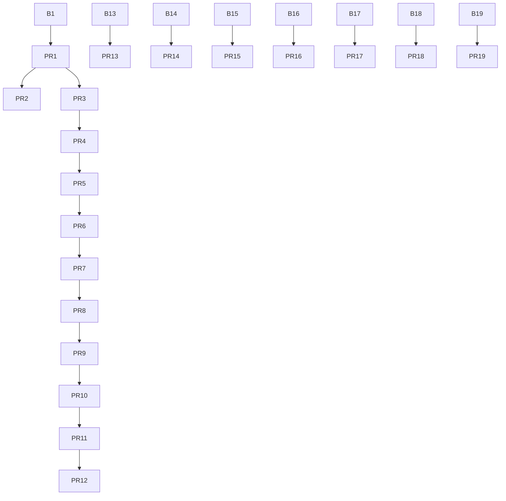

# PR coordination audit

Pinned HEAD `20ede51c6e5eddbf49fde709f8af5e77a319e1c7`, tree `688d9cdeb45ccc9d6657c981a514dd32635bee99`. Live API and local graph inspection; no source edits, merge, push, deployment or physical test. All 19 open PRs captured.

|PR|Base|Head SHA|Draft|Base ahead / PR ahead|Files|Contained in audit|
|---|---|---|---|---|---|---|
|1|main|18e50d855bd3be4bc50da8062f346b8026d01655|True|0 / 155|112|True|
|2|feat/math-universe-foundation|36b2166466aba08026ad80f8417bf3578bd143e1|False|0 / 10|26|True|
|3|feat/math-universe-foundation|bd53ee7486f145dbcc1fc2db8fb13eb04cd7999f|True|0 / 34|54|True|
|4|feat/book-postgres-integration-test|de94d0803844970c1076655d721f0de59e763cd0|True|0 / 6|24|True|
|5|feat/book-postgres-backend|8f666159da165e04999133fbe76bd0805a36b617|True|0 / 5|22|True|
|6|feat/book-postgres-lossless-json|8e19d00df3767ce6436e3d570b7a6fc661893c36|True|0 / 2|18|True|
|7|feat/book-postgres-cutover-controller|281800e142cf64f84edf58c61de0f5f862af5bc4|True|0 / 2|18|True|
|8|audit/book-cutover-hardening|1a0c26f7a3cb5f341c3ea9ad8a87009ef33c7b90|True|0 / 2|8|True|
|9|audit/book-migration-integrity|740f35742aa585f67471edea2fab5f5205a321f6|True|0 / 2|11|True|
|10|audit/book-full-ci-coverage|f1c29893d5826bdb2bfd24def2ee54a4377a9b8e|True|0 / 20|31|True|
|11|integration/math-remediation-abc|8dd1186f3fc34fa0148eb137cb44fc2416321e7c|True|0 / 14|21|True|
|12|fix/f01-f02-audit-hardening|2ecbfd9fb050d5e863122f2a47817ab1ac69e1f4|True|0 / 19|24|True|
|13|fix/f03-r06-independent-audit-findings|e45c14d75241a778df7b603bb8b58cdcf6304690|True|0 / 31|4|False|
|14|fix/f03-r06-independent-audit-findings|9e665156f050ddbfc2ddc1f2e038d8e7b99ca15e|True|0 / 57|21|False|
|15|fix/f03-r06-independent-audit-findings|6289bf7121a01bff6817a11b77bf4ddf82035286|True|0 / 35|6|False|
|16|review/base-proof-kernel-6c969ab|3240a1249b8242ed4ed11c2509c661f210b191d8|True|0 / 34|4|False|
|17|main|be843e7188d22aa707ef15c60036ad6ec10a2b6b|True|0 / 306|270|False|
|18|fix/f03-r06-independent-audit-findings|cb9288f0f890d5eafa961fb3eeb7229687a836b0|True|0 / 16|4|False|
|19|test/q01-queue-reliability|20ede51c6e5eddbf49fde709f8af5e77a319e1c7|True|0 / 1|50|True|

## Consolidation DAG

Base names that do not match an open PR head are external bridge branches; do not interpret them as direct main ancestry. See full SHA graph in pr-matrix.json.

## Content and overlap observations
- PR #1: ancestors among open PR heads []; base ancestor True; head in audit True.
- PR #2: ancestors among open PR heads [1]; base ancestor True; head in audit True.
- PR #3: ancestors among open PR heads [2, 1]; base ancestor True; head in audit True.
- PR #4: ancestors among open PR heads [3, 2, 1]; base ancestor True; head in audit True.
- PR #5: ancestors among open PR heads [4, 3, 2, 1]; base ancestor True; head in audit True.
- PR #6: ancestors among open PR heads [5, 4, 3, 2, 1]; base ancestor True; head in audit True.
- PR #7: ancestors among open PR heads [6, 5, 4, 3, 2, 1]; base ancestor True; head in audit True.
- PR #8: ancestors among open PR heads [7, 6, 5, 4, 3, 2, 1]; base ancestor True; head in audit True.
- PR #9: ancestors among open PR heads [8, 7, 6, 5, 4, 3, 2, 1]; base ancestor True; head in audit True.
- PR #10: ancestors among open PR heads [9, 8, 7, 6, 5, 4, 3, 2, 1]; base ancestor True; head in audit True.
- PR #11: ancestors among open PR heads [10, 9, 8, 7, 6, 5, 4, 3, 2, 1]; base ancestor True; head in audit True.
- PR #12: ancestors among open PR heads [11, 10, 9, 8, 7, 6, 5, 4, 3, 2, 1]; base ancestor True; head in audit True.
- PR #13: ancestors among open PR heads [12, 11, 10, 9, 8, 7, 6, 5, 4, 3, 2, 1]; base ancestor True; head in audit False.
- PR #14: ancestors among open PR heads [12, 11, 10, 9, 8, 7, 6, 5, 4, 3, 2, 1]; base ancestor True; head in audit False.
- PR #15: ancestors among open PR heads [12, 11, 10, 9, 8, 7, 6, 5, 4, 3, 2, 1]; base ancestor True; head in audit False.
- PR #16: ancestors among open PR heads [12, 11, 10, 9, 8, 7, 6, 5, 4, 3, 2, 1]; base ancestor True; head in audit False.
- PR #17: ancestors among open PR heads [12, 11, 10, 9, 8, 7, 6, 5, 4, 3, 2, 1]; base ancestor True; head in audit False.
- PR #18: ancestors among open PR heads [12, 11, 10, 9, 8, 7, 6, 5, 4, 3, 2, 1]; base ancestor True; head in audit False.
- PR #19: ancestors among open PR heads [12, 11, 10, 9, 8, 7, 6, 5, 4, 3, 2, 1]; base ancestor True; head in audit True.

Independent-head file overlaps (not demonstrated conflicts):
- #13 / #17: 1 common paths; src/book-ingestion/queue-contract.mjs.
- #13 / #19: 2 common paths; src/book-ingestion/knowledge-boundary.mjs, tests/book-ingestion-knowledge-boundary.test.mjs.
- #14 / #19: 21 common paths; .github/workflows/ai-orchestrator-policy.yml, docs/AI_CODEX_ORCHESTRATOR_MVP.md, src/ai-orchestrator/artifacts.mjs, src/ai-orchestrator/claims.mjs, src/ai-orchestrator/inspect.mjs, src/ai-orchestrator/plan.mjs, src/ai-orchestrator/policy.mjs, src/ai-orchestrator/receipts.mjs, src/ai-orchestrator/registry.mjs, src/ai-orchestrator/replay.mjs, src/ai-orchestrator/stream.mjs, tests/ai-orchestrator-artifacts.test.mjs. Full list in JSON.
- #15 / #17: 1 common paths; src/book-ingestion/queue.mjs.
- #15 / #18: 1 common paths; src/book-ingestion/queue.mjs.
- #15 / #19: 5 common paths; .github/workflows/qa-q01-diagnostic.yml, docs/qa-independent-acceptance-contract.md, scripts/qa-evidence-manifest.mjs, tests/qa-evidence-manifest.test.mjs, tests/qa-q01-first-open.test.mjs.
- #16 / #19: 4 common paths; .github/workflows/proof-kernel-isolated.yml, docs/proof-kernel-mvp.md, src/proof-kernel.mjs, tests/proof-kernel.test.mjs.
- #17 / #18: 2 common paths; src/book-ingestion/queue.mjs, tests/book-ingestion-queue.test.mjs.
- #17 / #19: 16 common paths; src/knowledge/candidate-graph.mjs, src/knowledge/candidate-store.mjs, src/knowledge/file-replay-ledger.mjs, src/knowledge/kernel-authenticator.mjs, src/knowledge/kernel-result-boundary.mjs, src/knowledge/one-shot-verifier.mjs, src/knowledge/verification-request.mjs, tests/knowledge-candidate.test.mjs, tests/knowledge-file-replay-ledger.test.mjs, tests/knowledge-kernel-authenticator.test.mjs, tests/knowledge-kernel-result.test.mjs, tests/knowledge-ledger-directory.test.mjs. Full list in JSON.
- #18 / #19: 2 common paths; docs/audits/SQLITE_Q01_RELIABILITY_GATE_20261022.md, tools/bench-book-queue-rewrite.mjs.
